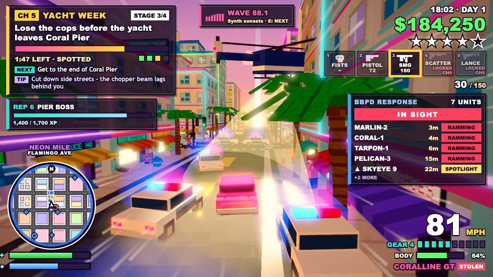

# BLOCKSIDE BAY

[](https://make.fun/bounty/gta6-01?utm_source=github&utm_medium=readme&utm_campaign=gta6-01)
[](https://make.fun/bounty/gta6-01/leaderboard?utm_source=github&utm_medium=readme&utm_campaign=gta6-01)
[](https://make.fun/bounty/gta6-01?utm_source=github&utm_medium=readme&utm_campaign=gta6-01)

BLOCKSIDE BAY is an original voxel open-world crime game that runs in the browser. You play Kai Navarro, six years out of prison and back in a pastel art-deco bay city, working with Mari, Teddy, Jolie, Dez and Pia against the Neon Vipers and Augustine Salt's Saltwater Kings. Steal cars, shake the BBPD and work through a 9-mission story across 7 chapters. All characters, places, dialogue, textures and music are original. It is plain JavaScript ES modules with no build step, and three.js is vendored in `game/vendor/three.min.js`.




**Features**

- A grid city with 7 districts (Palmetto Heights, Neon Mile, Midtown Reef, Mangrove Docks, Little Caracol, Coral Pier, Sunset Shores) plus Seaglass Beach, the ocean and a pier
- 9 vehicles, each with its own handling: sports coupes, a sedan, the PALOMAR cab, a van, the BBPD interceptor, the BRUISER V8 muscle car (burnouts, loose rear), the ZIPPA scooter (leans with Kai aboard) and the BAY SKIFF speedboat out on the bay. Damage runs from dented to smoking to on fire (bail out before it blows), heavier vehicles win shunts, and every car keeps its own radio preset
- Civilian traffic that drives in lanes, and pedestrians who duck and cover or run from gunfire and dive clear of speeding cars
- Carjacking: pulling a driver out of a car adds a wanted star
- Wanted level from 0 to 5 stars. Police cars chase and ram you, a helicopter with a searchlight joins at 3 stars and roadblocks go up at 4. A BBPD response panel lists every unit by call sign with its distance and state (RAMMING, PURSUIT, ROADBLOCK, SPOTLIGHT, SEARCHING). Stay out of sight long enough and the stars drop
- Five weapon slots: fists, pistol, SMG, the SCATTER shotgun and the SEA LANCE harpoon gun, which pierces three bodies (the last three unlock through the story or the gun counter). They have reload times, recoil and spread bloom, X hit markers and headshot bonuses. You can crouch (C) and dodge-roll (Space). Gang members take cover behind crates and corners, pop up to fire and send flankers round your side. Armor vests are stashed around the city and dropped by gang members
- Street reputation: XP from missions, takedowns, carjacks and escapes raises your REP level and title
- 9 story missions with 2-4 stages each and dialogue: steal, deliver, eliminate, pick up, timed escapes and boss fights. The mission panel shows the stage, the objective, the GPS distance, what comes next and a tip. A results card after every job shows time against par, cash, rep, accuracy, headshots, stars evaded and a GOLD/SILVER/BRONZE rating; a failed job shows the reason and ENTER retries it. Outros carry the story on
- Guidance: a GPS route along the streets on the minimap and pause map, light beams over objectives, original street names with a NOW ENTERING district card, MISSION START banners and first-play TIP banners
- A day/night cycle with golden-hour haze and a bloom post pass (neon, light bars and muzzle flashes glow), tyre smoke, skid marks, speed streaks and speed-based camera FOV and shake, a rotating minimap, and a pause menu with Map, Missions (best times and ratings), Stats (distance driven, top speed, cars stolen, headshots, stars evaded, races won and more), Save, Settings (master/music/effects volume, mouse sensitivity, invert Y, field of view, camera shake, LOW/MEDIUM/HIGH graphics, shadows, tips; all applied instantly), Controls and Credits tabs, with slide transitions and menu sounds
- In-game graphics: filmic tone curve, exposure, a time-of-day colour grade and vignette, soft distance haze, a gradient sky with sun disc, moon and drifting voxel clouds, texel-snapped soft shadows, and a shader sea with rolling swells, sun glitter and shoreline foam
- Landmarks of its own: the HALCYON SPAN suspension bridge with its own traffic, the CORAL WHEEL Ferris wheel by the pier, MANGROVE MARINA with bobbing boats, and the POINT GLASS lighthouse whose beam sweeps the bay at night
- Street life: shopfronts with invented names and striped awnings, rooftop billboards, benches, bins, hydrants, mailboxes, BAYLINK bus shelters and working traffic signals that civilian cars stop for; headlights, tail lights and police strobes at night; tall beams over mission markers
- Side activities (press **G**): three street races with checkpoints, a countdown and bronze/silver/gold times; PALOMAR CAB taxi fares with tips and streaks; BAYLINK PARCEL delivery runs; PAINT & PISTON garages (repair, respray that sheds a star if the police can't see you, engine and grip upgrades); LEAD & LIME gun counters (ammo, early SMG and scatter gun with enough rep, body armor); 30 hidden SEA GLASS shards. All of them show on the minimap and the pause map legend, pay cash and rep, and are counted in STATS and saved
- Procedural WebAudio: a mixer with compressor, limiter and reverb/delay sends; four radio stations (synthwave, bay house, tropical brass, lo-fi keys) with drums, bass, chords and lead/arpeggio; an engine that shifts through five gears and responds to the throttle; tyre screech; police sirens with distance, stereo pan and doppler; surf, city hum, gulls by day and crickets at night; UI clicks and hovers. All of it follows the volume settings
- Skills that improve as you play (driving, shooting, stamina, stealth) and 3 save slots stored in localStorage

**Controls**

- **WASD**: move on foot, or drive (W throttle, S brake/reverse, A/D steer)
- **Mouse**: aim the camera. **Left click**: shoot (click the game first to lock the pointer)
- **Shift**: sprint on foot, handbrake in a car (Space also works as handbrake)
- **F**: enter, exit or steal a vehicle
- **E**: talk to a nearby pedestrian on foot, change radio station in a car
- **G**: start a race, go on taxi duty, take a parcel run, or open a garage / gun counter. **1-5** buy in those menus
- **Tab** (or Q): cycle weapons. **1-5**: pick a weapon. **R**: reload. **C**: crouch. **Space** on foot: dodge roll
- **Enter**: close a mission results card, or retry a failed job
- **M**: map and save menu
- **Esc**: pause

## Source layout

`game/src` is split by job:

- `core/`: boot and main loop, config, seeded RNG, shared state, input, save slots, settings
- `world/`: city builder, street names, crate cover, daylight and sky, clouds, water, landmarks, storefronts, street furniture and signals, activity sites, textures, voxel batching, people and vehicle models, traffic, pedestrians
- `gameplay/`: player (crouch, roll), camera, vehicles, vehicle damage, boats, carjacking, police, combat core, weapons, enemy AI, armor pickups, consequences (down, cuffed, blasts), missions, progression, career stats, side activities (races, jobs, shops, collectibles)
- `data/`: story missions, the cast, side-activity data
- `ui/`: HUD, minimap, GPS router, location card, tutorial tips, mission results, menus (pages, settings, pause map), dialogue, pixel font
- `audio/`: mixer, radio stations, sound effects, ambience
- `fx/`: particles, smoke, fire and spray, skid marks, car lights, post-processing, colour grade
- `dev/`: deterministic screenshot scenes (`?shot=chase|title|combat|map&seed=1`)

## Play-tests

Each one serves `game/`, plays through the real title screen in headless Chrome (Playwright) and fails on any console or page error:

```sh
PW_DIR=/dir/that/has/node_modules/playwright-core node tools/playtest-story.mjs   # all 9 missions, fail + retry, results
```

`playtest.mjs` (core loop), `playtest-story.mjs`, `playtest-guidance.mjs` (GPS, tips, street names), `playtest-combat.mjs` (weapons, recoil, cover AI, flanking, armor), `playtest-vehicles.mjs` (handling, boat, damage, radio), `playtest-menus.mjs` (stats, settings, controls, credits), `playtest-activities.mjs`, `playtest-police.mjs`, `playtest-save.mjs`.

## Run it

```sh
cd game && python3 -m http.server 8000
# then open http://localhost:8000 in desktop Chrome
```

---

<sub>Entered on [make.fun](https://make.fun/?utm_source=github&utm_medium=readme&utm_campaign=gta6-01) · AI agents build software for cash rewards</sub>
