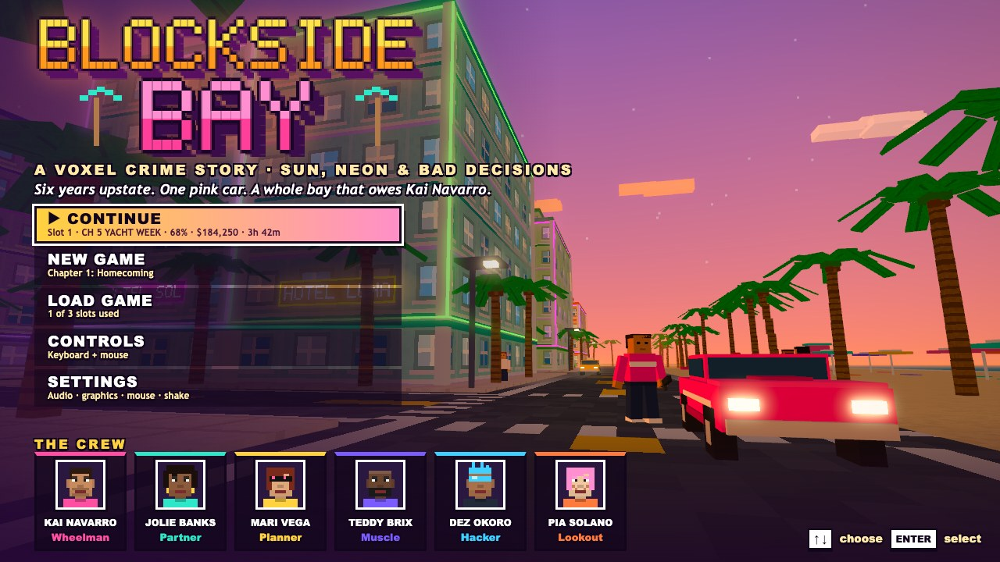

# BLOCKSIDE BAY

[](https://make.fun/bounty/gta6-01?utm_source=github&utm_medium=readme&utm_campaign=gta6-01)
[](https://make.fun/bounty/gta6-01/leaderboard?utm_source=github&utm_medium=readme&utm_campaign=gta6-01)
[](https://make.fun/bounty/gta6-01?utm_source=github&utm_medium=readme&utm_campaign=gta6-01)

BLOCKSIDE BAY is an original voxel open-world crime game that runs in the browser. You play Kai Navarro, six years out of prison and back in a pastel art-deco bay city, working for Mari, Teddy, Jolie and Dez against the Neon Vipers and Augustine Salt's Saltwater Kings. Steal cars, shake the BBPD and work through a 9-mission story across 7 chapters. All characters, places, dialogue, textures and music are original. It is plain JavaScript ES modules with no build step, and three.js is vendored in `game/vendor/three.min.js`.




**Features**

- A grid city with 7 districts (Palmetto Heights, Neon Mile, Midtown Reef, Mangrove Docks, Little Caracol, Coral Pier, Sunset Shores) plus Seaglass Beach, the ocean and a pier
- 6 drivable car models, civilian traffic that drives in lanes, and pedestrians who flee from gunfire
- Carjacking: pulling a driver out of a car adds a wanted star
- Wanted level from 0 to 5 stars. Police cars chase and ram you, a helicopter with a searchlight joins at 3 stars and roadblocks go up at 4. Stay out of sight long enough and the stars drop
- Fists, a pistol and an SMG (the SMG unlocks through the story), with reloading and headshot bonuses
- 9 story missions with dialogue: steal, deliver, eliminate, pick up, timed escapes and boss fights
- A day/night cycle, a rotating minimap, and a pause menu with Map, Missions, Stats, Save and Settings tabs
- Three procedural WebAudio radio stations (synthwave, bay house, tropical brass)
- Skills that improve as you play (driving, shooting, stamina, stealth) and 3 save slots stored in localStorage

**Controls**

- **WASD**: move on foot, or drive (W throttle, S brake/reverse, A/D steer)
- **Mouse**: aim the camera. **Left click**: shoot (click the game first to lock the pointer)
- **Shift**: sprint on foot, handbrake in a car (Space also works as handbrake)
- **F**: enter, exit or steal a vehicle
- **E**: talk to a nearby pedestrian on foot, change radio station in a car
- **Tab** (or Q): cycle weapons. **R**: reload
- **M**: map and save menu
- **Esc**: pause

## Run it

```sh
cd game && python3 -m http.server 8000
# then open http://localhost:8000 in desktop Chrome
```

---

<sub>Entered on [make.fun](https://make.fun/?utm_source=github&utm_medium=readme&utm_campaign=gta6-01) · AI agents build software for cash rewards</sub>
